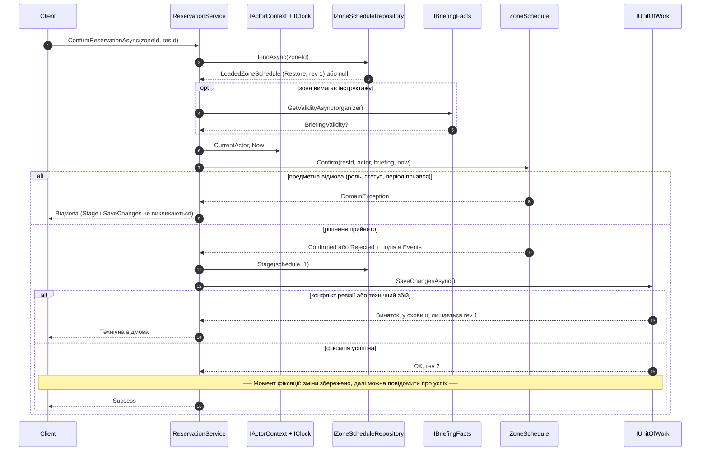

# CoworkingLab — коворкінг підприємства ЛР 4

C# / .NET 8. Відкривати у Visual Studio 2022: `CoworkingLab.sln`.

**ЛР 4** — прикладні сценарії, порти, навчальні адаптери збереження, відновлення агрегатів .

## Контексти та відповідальність

| Обмежений контекст | Програмний модуль | Корінь агрегату | Прикладна служба (ЛР 4) | Автор |
|---|---|---|---|---|
| Погодження резервування | `src/Reservations.Domain` | `ZoneSchedule` (розклад зони) | `ReservationService` | Мороз Іван |
| Облік інструктажів організаторів | `src/Briefings.Domain` | `BriefingRecord` (облікова картка інструктажів) | `BriefingService` | Тур Маргарита |
| Фіксація використання зони | `src/ZoneUsage.Domain` | `ZoneUsageRecord` (використання зони) | `ZoneUsageService` | Лєбідинський Дмитро |
| Ідентифікація та доступ (generic) | — готове корпоративне рішення | — | — | — |

## Структура

```
CoworkingLab/
├── CoworkingLab.sln
├── src/
│   ├── Reservations.Domain/
│   │   ├── Entities/      Reservation.cs, ZoneSchedule.cs                  (namespace Reservations.Domain)
│   │   ├── ValueObjects/  Identifiers.cs, TimeSlot.cs, BookingPolicy.cs, ZoneProfile.cs, Actor.cs,
│   │   │                  BriefingValidity.cs, Rejection.cs, DomainEvents.cs, DomainException.cs
│   │   ├── Ports/         IZoneScheduleRepository.cs, IUnitOfWork.cs, IActorContext.cs, IClock.cs,
│   │   │                  IBriefingFacts.cs                                 (namespace Reservations.Application)
│   │   ├── Services/      ReservationService.cs                            (namespace Reservations.Application)
│   │   └── Persistence/   ReservationMemorySession.cs                      (namespace Reservations.Infrastructure)
│   ├── Briefings.Domain/
│   │   ├── Entities/      BriefingRecord.cs
│   │   ├── ValueObjects/  ValueObjects.cs, DomainEvents.cs, DomainException.cs
│   │   ├── Ports/         IBriefingRecordRepository.cs, IUnitOfWork.cs, IActorContext.cs, IClock.cs
│   │   ├── Services/      BriefingService.cs
│   │   └── Persistence/   BriefingMemorySession.cs
│   └── ZoneUsage.Domain/
│       ├── Entities/      ZoneUsageRecord.cs
│       ├── ValueObjects/  ValueObjects.cs, DomainEvents.cs, DomainException.cs
│       ├── Ports/         IZoneUsageRepository.cs, IUnitOfWork.cs, IActorContext.cs, IClock.cs
│       ├── Services/      ZoneUsageService.cs
│       └── Persistence/   ZoneUsageMemorySession.cs
└── tests/
    └── Coworking.Tests/
        ├── Reservations/
        │   ├── Domain/       ReservationFixture.cs, ValueObjectTests.cs, ZoneScheduleTests.cs
        │   ├── Application/  ReservationServiceTests.cs
        │   └── Integration/  ReservationStorageTests.cs
        ├── Briefings/
        │   ├── Domain/       BriefingRecordTests.cs
        │   ├── Application/  BriefingServiceTests.cs
        │   └── Integration/  BriefingStorageTests.cs
        └── ZoneUsage/
            ├── Domain/       ZoneUsageRecordTests.cs
            ├── Application/  ZoneUsageServiceTests.cs
            └── Integration/  ZoneUsageStorageTests.cs
```

Шари розділено за папками та просторами імен: `*.Domain` — предметна модель, `*.Application` — прикладні служби й порти, `*.Infrastructure` — адаптери збереження. Фізично всі три шари контексту поки що в одній збірці `*.Domain.csproj`, тому межу між ними компілятор не контролює. Винесення в окремі проєкти `*.Application` та `*.Infrastructure` — відкрите питання.

Предметних служб немає: усі правила реалізованих сценаріїв мають природного власника — корінь агрегату.

## Прикладні сценарії

| Служба | Метод | Предметна дія агрегату | Зовнішні факти |
|---|---|---|---|
| `ReservationService` | `ConfirmReservationAsync(zoneId, reservationId)` | `ZoneSchedule.Confirm` → `Confirmed` або `Rejected` | актор, час, `BriefingValidity` через `IBriefingFacts` (лише для зон з обов'язковим інструктажем) |
| `BriefingService` | `RecordBriefingAsync(personId, conductedAt)` | `BriefingRecord.RecordBriefing` (нова картка створюється, якщо її ще немає) | актор, час |
| `BriefingService` | `RevokeBriefingAsync(personId, reason)` | `BriefingRecord.Revoke` | актор, час |
| `ZoneUsageService` | `StartUsageAsync` / `CompleteUsageAsync` / `DeclareNoShowAsync` | `ZoneUsageRecord.Start` / `Complete` / `DeclareNoShow` | актор, час |

Виконання сценарію:

1. `FindAsync` завантажує агрегат через `Restore` разом із ревізією.
2. Служба отримує довірені факти з портів `IActorContext`, `IClock`, `IBriefingFacts`.
3. Агрегат виконує предметну дію або кидає `DomainException`. У разі відмови `Stage` і `SaveChangesAsync` не викликаються.
4. `Stage(aggregate, expectedRevision)` готує зміну, `IUnitOfWork.SaveChangesAsync()` її фіксує.
5. Про успіх можна повідомити лише після успішного `SaveChangesAsync`.




## Збереження та відновлення

Знімок стану агрегату (`ZoneScheduleState`, `BriefingRecordState`, `ZoneUsageState`) разом із ревізією `long`. Предметні події не зберігаються.
Статичні методи `Restore(state)` створюють новий екземпляр агрегату. Вони перевіряють узгодженість збереженого стану: обов'язкові складові, допустимі комбінації статусу й часових міток, відсутність дублікатів і перетинів активних резервувань, хронологію інструктажів. `Restore` не повторює історичні команди, не застосовує поточні зовнішні умови до минулих рішень і не створює подій — список `Events` після відновлення порожній.
`Stage` запам'ятовує очікувану ревізію. `SaveChangesAsync` спочатку перевіряє ревізії всіх підготовлених змін і лише потім записує їх, збільшуючи ревізію на 1. Якщо поточна ревізія відрізняється від очікуваної, буфер очищується, кидається виняток, а збережений стан лишається без змін. Нові записи мають ревізію 0, початкові дані сесії — 1.

### Обмеження навчальних адаптерів `*MemorySession`

- Дані зберігаються лише в оперативній пам'яті процесу й зникають після його завершення.
- Кожна сесія фіксує зміни лише свого контексту. Спільної транзакції між контекстами немає.
- Конфлікт ревізій зараз повідомляється через `DomainException`, тобто технічна відмова не відрізняється від предметної за типом винятку.
- Предметні події лишаються в пам'яті агрегату й нікуди не публікуються, тож доставлення іншим контекстам не гарантується.
- Після невдалої фіксації об'єкт у пам'яті вже змінений. Для повторної спроби агрегат потрібно завантажити заново.
- Реального адаптера для `IBriefingFacts` немає, у тестах використовується заглушка.
